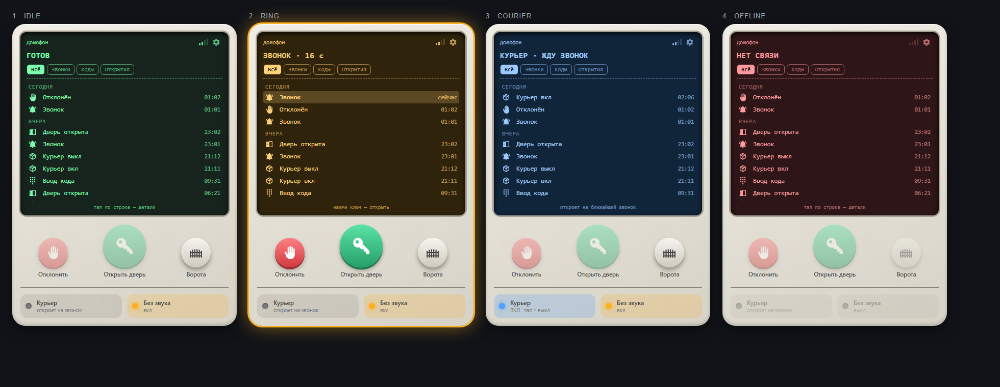

<h1 align="center">Intercom Card</h1>

<p align="center">
  A Lovelace card for an ESPHome door intercom, drawn like a wall panel: a colour LCD with the live status and the
  <b>history of rings, code entries and door/gate openings</b>, big keys for the door and the gate, courier mode and mute.
</p>

<p align="center">
  
</p>

Built for the ESPHome "Domofon" device (ring sensor, code-entry sensor, open-door / open-gate / reject buttons, courier-mode
and mute switches), but every entity is configurable. No brand marks, shapes only.

## Features

- **Live status on the LCD.** Ready, ringing (with a seconds counter), entering a code, courier mode waiting, no connection.
  The screen and the panel frame change colour: green, amber (ring), blue (courier), red (offline).
- **History on the screen.** Rings (with duration), code entries, door and gate openings, rejected calls and courier mode
  on/off, grouped by day. Filters: All / Rings / Codes / Openings. Tap a row for the exact time and the length of a call.
  Taken from the recorder, so it survives restarts; the list refreshes by itself when something happens.
- **Keys that make sense.** *Open door* and *Reject* are only live during a call (the intercom ignores them otherwise) and
  the door key pulses while it rings. *Gate* works any time.
- **Courier mode** (any ring opens the door by itself) is a lit toggle with a clear hint; the screen turns blue while it is on.
- **Mute** toggle, signal bars and a settings page (external antenna, Wi-Fi level, device state) behind the gear.
- Adapts to the entities you have: keys and toggles for missing entities are hidden.
- **Translations** (English by default, Russian included) in plain files that are easy to extend.

## What the history can and cannot show

| Shown | Source |
|---|---|
| Rings and how long they lasted | `doorbell_ring` binary sensor |
| A code was entered | `code_entry` binary sensor. **The code itself is not exposed by the device.** |
| Door / gate opened, call rejected | the ESPHome buttons: their state is the time of the last press |
| Courier mode on / off | the switch |

Who opened the door (this card, Telegram, courier mode) is not recorded anywhere, so the list just says "Door opened".

## Installation

### HACS

HACS → ⋮ → *Custom repositories* → add `https://github.com/dimabutenko/ha-intercom-card` with type *Dashboard*
(Lovelace), then download **Intercom Card**.

### Manual

1. Download `intercom-card.js` from the latest [release](https://github.com/dimabutenko/ha-intercom-card/releases/latest)
   and copy it to `/config/www/community/ha-intercom-card/`.
2. Add it as a dashboard resource (Settings → Dashboards → ⋮ → Resources → Add resource):
   URL `/local/community/ha-intercom-card/intercom-card.js`, type *JavaScript module*.

## Configuration

```yaml
type: custom:intercom-card
prefix: domofon
```

| Option | Default | Description |
|---|---|---|
| `prefix` | – | Entity id prefix shared by the device's entities (`domofon` → `button.domofon_open_door`, ...). Required unless `entities` is complete. |
| `name` | translated "Intercom" | Title on the screen. |
| `language` | Home Assistant language | `en` or `ru`. |
| `history_days` | `7` | How many days of history to load (1–30). |
| `entities` | derived from `prefix` | Per-role overrides, see below. |

Entity roles and their default ids (all optional, a missing entity hides its part of the card):

| Role | Default |
|---|---|
| `ring` | `binary_sensor.<prefix>_doorbell_ring` |
| `code_entry` | `binary_sensor.<prefix>_code_entry` |
| `door` | `button.<prefix>_open_door` |
| `gate` | `button.<prefix>_open_gate` |
| `reject` | `button.<prefix>_reject_call` |
| `courier` | `switch.<prefix>_courier_mode` |
| `mute` | `switch.<prefix>_mute` |
| `antenna` | `switch.<prefix>_external_antenna` |
| `wifi` | `sensor.<prefix>_wifi_signal` |

There is also a visual editor with the same options.

## Development

```sh
npm install
npm run build        # src/ -> intercom-card.js (esbuild bundle, not committed)
node dev/history.test.mjs
```

`dev/preview.html` renders the card against a fake `hass` (no Home Assistant needed). ES modules do not load from
`file://`, so serve the folder with any static server and open `/dev/preview.html` (`?lang=en` for English).
CI builds the bundle and attaches it to each `v*` release, which is what HACS installs.
